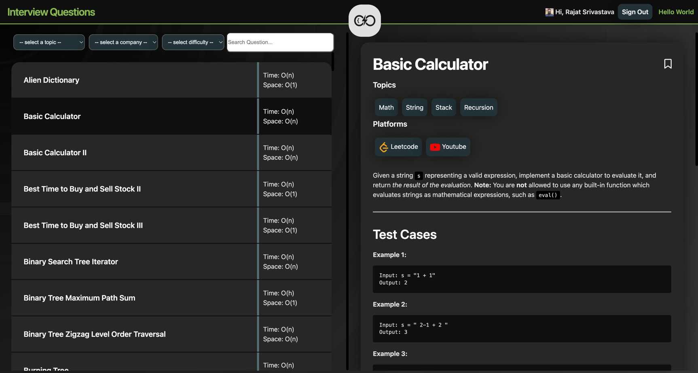
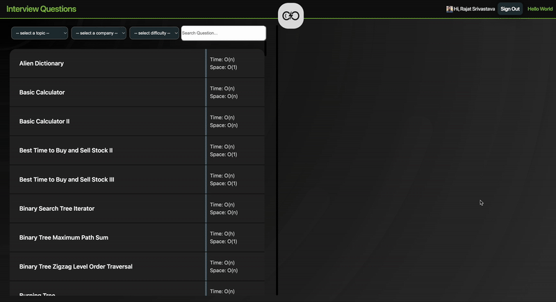

# Interview Questions


A collection of top interview questions asked in DSA rounds of companies. The project now uses Astro for a faster static site with interactive UI.

The project contains solutions of the questions in multiple languages, the questions are also tagged with topics and companies.

See list of supported languages and platforms, check
1. [languages](_data/languages.yml)
2. [platforms](_data/platforms.yml)

Folks can also login using google (supported through Firebase) and bookmark questions and view their bookmarked questions.

Website: [interview-questions](https://rajat19.github.io/interview-questions/)





Questions are present inside `src/content/questions/`, with their working solutions available in `src/code/<slug>/solution.<ext>`.

### Sample coding question post [hello-world.md](/hello-world.md)

```markdown
---
layout: post
title: Hello World
topics: string
langs: java py c cpp go js php cs rb rust scala kt
tc: O(1)
sc: O(1)
leetid: 0
---

Print Hello appended by input string

---

## Test Cases

**Input:** 
	
	(string) s = "World"

**Output:** 

	(string) "Hello World"
```

### Setup (Astro + Tailwind + DaisyUI + Firebase)

1. Install Node 18+
2. Install deps
   ```shell
   npm install
   ```
3. Migrate content (from legacy Jekyll folders to Astro structure)
   ```shell
   npm run migrate
   ```
4. Start dev server
   ```shell
   npm run dev
   ```

Build and preview
```shell
npm run build
npm run preview
```